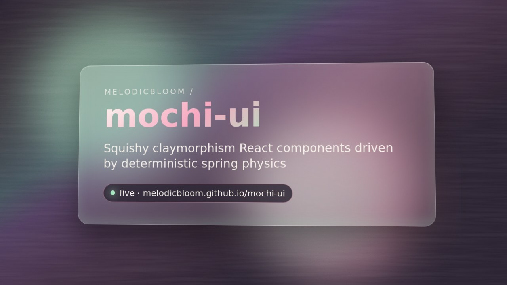

# Mochi UI 🍡

> A **Claymorphism Design System** built with Astro, React, and Motion — featuring spring physics, tactile haptic feedback, and Figma-native compatibility.


## ✨ Philosophy

**If it looks like clay, animates like clay, it must feel like clay.**

Mochi UI implements the complete tactile web playbook:
- **Pastel Psychology** — Reduced cognitive load through curated tints
- **Shadow Matrix** — 4-layer depth system (Base → Lift → Volume → Reflection)
- **Spring Physics** — Bounce + Perceptual Duration parameters (no Mass/Stiffness/Damping)
- **Haptic Synchronization** — Device hardware feedback mapped to visual states
- **Bento Grids** — Japanese bento-inspired compartmentalization

## 🚀 Quick Start

```bash
# Clone and install
npm install

# Start dev server
npm run dev

# Build for production
npm run build

# Export design tokens to Figma
npm run tokens
```

## 🎨 Design Tokens (W3C Format)

All tokens follow the [W3C Design Tokens Format](https://design-tokens.github.io/format/) for universal compatibility:

```json
{
  "mochi.color.rainbow.mint": { "$type": "color", "$value": "#A3E635" },
  "mochi.shadow.lift.md": { "$type": "shadow", "$value": { ... } },
  "mochi.motion.spring.bounce": { "$type": "number", "$value": 0.4 }
}
```

### Figma Integration

| Export Format | Use Case |
|--------------|----------|
| `tokens-studio.json` | [Tokens Studio](https://tokens.studio) plugin |
| `figma-variables.json` | Native Figma Variables API |
| `variables.css` | CSS custom properties import |
| `component-specs.json` | Component anatomy documentation |

## 🧱 Component Library

### Clay Primitives

| Component | Features | Physics |
|-----------|----------|---------|
| `ClayButton` | Triple-shadow, 6 colorways, 3 sizes | Compression → Overshoot → Settle |
| `ClayCard` | 4-layer shadow, 3D tilt on hover, shine effect | Floating parallax |
| `ClayToggle` | Spring knob, track recess, haptic tick | Elastic snap |
| `ClaySlider` | Tactile knob, granular feedback, fill animation | Drag + release |
| `ClayInput` | Inset recess, glow focus, validation | Scale pulse |
| `ClayChartBar` | 3D cylinder, volumetric shadow, tooltip | Grow from bottom |
| `ClayBadge` | Pulse animation, micro-float | Scale bounce |
| `ClayAvatar` | Status indicator, rotation on hover | Tilt + scale |

### Animation Systems

| System | Purpose |
|--------|---------|
| `SpringPhysics` | Bounce + Duration configuration |
| `ClayRebound` | 3-phase animation (Compression → Overshoot → Settle) |
| `FloatingContainer` | Ambient breathing animation |
| `FloatingGroup` | Staggered floating elements |
| `ParallaxLayer` | Mouse-driven depth |

## 🎯 Physics Presets

```tsx
import { physicsPresets, PhysicsProvider } from 'mochi-ui';

// Available presets
const presets = {
  jelly:       { bounce: 0.8, duration: 500 },  // Maximum elasticity
  clay:        { bounce: 0.4, duration: 300 },  // Standard (default)
  firm:        { bounce: 0.15, duration: 200 }, // Minimal bounce
  snappy:      { bounce: 0.2, duration: 150 },  // Quick response
  luxurious:   { bounce: 0.5, duration: 600 },   // Slow elegance
  bouncy:      { bounce: 0.9, duration: 400 },  // Playful
};

// Apply to entire app
<PhysicsProvider config={physicsPresets.jelly}>
  <App />
</PhysicsProvider>
```

## 📐 Shadow Matrix

The 4-layer CSS shadow system creates physical depth:

```css
.clay-surface {
  /* Layer 1: Base color */
  background: hsl(120deg 35% 82%);

  /* Layer 2: Lift — floating depth */
  box-shadow: 0 8px 16px rgba(0,0,0,0.1);

  /* Layer 3: Volume — 3D inflation */
  box-shadow: inset -10px -10px 20px rgba(0,0,0,0.05);

  /* Layer 4: Reflection — light source */
  box-shadow: inset 10px 10px 20px rgba(255,255,255,0.8);
}
```

## 🌗 Dark Mode

```tsx
// Never use pure black — always elevated darks
document.documentElement.setAttribute('data-theme', 'dark');
```

| Mode | Base | Surface | Card |
|------|------|---------|------|
| Light | `#F5E6D3` | `#FFF8F0` | `#FFFFFF` |
| Dark | `#1E1E2E` | `#2D2D44` | `#252538` |

## 🎭 State Lifecycle

Every interactive component follows the 3-state tactile lifecycle:

```
┌─────────────┐    ┌─────────────┐    ┌─────────────┐
│   DEFAULT   │ →  │    HOVER    │ →  │    ACTIVE   │
│   Floating  │    │   Lifted    │    │  Compressed │
│  (shadow↑)  │    │ (shadow↑↑)  │    │ (inset↓)    │
└─────────────┘    └─────────────┘    └─────────────┘
```

## 📱 Haptic Feedback

```tsx
import { triggerHaptic } from 'mochi-ui';

// Mapped to UI components
triggerHaptic({ enabled: true, intensity: 'soft' });   // Button press
triggerHaptic({ enabled: true, intensity: 'medium' });   // Toggle
triggerHaptic({ enabled: true, intensity: 'firm' });    // Deep press
```

## 🏗️ Architecture

```
mochi-ui/
├── src/
│   ├── components/
│   │   ├── clay/           # 8 primitive components
│   │   ├── animations/     # Physics & motion systems
│   │   ├── layout/         # BentoGrid, containers
│   │   └── ShowcasePage.tsx # Interactive demo
│   ├── styles/
│   │   ├── tokens.css      # CSS custom properties
│   │   └── clay.css        # Component styles
│   ├── tokens/
│   │   └── tokens.json     # W3C format tokens
│   └── pages/
│       └── index.astro     # Main entry
├── figma-export/           # Generated Figma assets
├── scripts/
│   └── build-tokens.js     # Token transformation
└── package.json
```

## 🎨 Color Palettes

| Theme | Mood | Colors |
|-------|------|--------|
| Rainbow | Whimsical | Mint, Baby Blue, Lavender, Peach |
| Pink & Red | Romantic | Blush Pink, Soft Rose |
| Blue | Serene | Powder Blue, Sky Blue |
| Green | Natural | Sage, Mint Green |
| Neutrals | Sophisticated | Ivory, Soft Taupe |

## 📄 License

MIT © 2026 Mochi UI

## Storybook

```bash
npm run storybook        # dev server on http://localhost:6006
npm run build-storybook  # static build → storybook-static/
```

Stories live in `src/stories/` (Clay/Button, Clay/Card, Clay/Surfaces, Motion/Clay Rebound, Motion/Spring Playground).
The static build uses a relative base, so it can be served from any sub-path. To publish it next to the Astro site on
GitHub Pages, run `npm run build:pages` (Astro → `dist/`, Storybook → `dist/storybook/`) in the Pages workflow and it
will appear at `https://melodicbloom.github.io/mochi-ui/storybook/`. The existing Pages deploy is unchanged by this PR.

## Spring physics playground

Route: `/playground/springs` (Astro, `client:only` React) and Storybook **Motion/Spring Playground**.
Tune stiffness / damping / mass (or pick a `MOCHI_SPRING_PRESETS` preset), see the damping ratio ζ, implied bounce and
the step-response curve, and press-and-hold the clay blob to feel it. Driven by `@melodicbloom/mochi-spring`
(`packages/spring-engine`). `prefers-reduced-motion: reduce` snaps springs to their target instantly.

## npm package — `@melodicbloom/mochi-ui`

`packages/mochi-ui` bundles the React components (ESM + CJS + `.d.ts`) with `react`, `react-dom`, `motion` as peers,
plus `@melodicbloom/mochi-ui/styles.css` and `/tokens.css`. The spring engine is re-exported as `spring`.

```bash
npm run pkg:pack                                  # build + npm pack --dry-run
cd packages/mochi-ui && npm publish --access public   # requires npm login with publish rights on @melodicbloom
```

## Visual proof

[](docs/visual-proof/hero.mp4)

[](https://melodicbloom.github.io/mochi-ui/)

- `docs/visual-proof/hero.mp4` / `hero-poster.jpg` / `og.png` — rendered with [visual-proof-kit](https://github.com/MelodicBloom/visual-proof-kit)
- `docs/visual-proof/demo-storybook.png`, `demo-springs.png` — Storybook + playground screenshots

Lighthouse: run locally — `npx lighthouse https://melodicbloom.github.io/mochi-ui/ --view`
